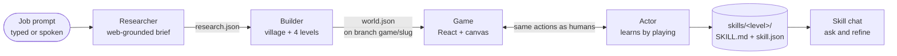

# ReplaceMe

**Type a job. Get a game that teaches it. Watch an AI agent learn it by playing, and keep the skills it writes down.**

[](LICENSE)


ReplaceMe turns any hands-on job (barista, florist, doctor, rocket scientist) into a cozy, Stardew-style village game. A researcher agent studies the job on the web, a builder agent turns that research into four playable quest levels with fixed scoring rules, and an actor agent plays those levels like a trainee would. It changes one thing at a time, reads the feedback, and exports one reusable **skill** per level: a `SKILL.md` with the learned parameters, the evidence behind them, and the steps to run them with real tools.

> Built in one day at the [**{Tech: Europe} Agentic AI Hack**](https://luma.com/zrh-hack?tk=K2XLTF) in Zürich (October 2026), hosted with Google DeepMind, with Gradium and Entire as technology partners.

## Contents

- [How it works](#how-it-works)
- [Features](#features)
- [Quick start](#quick-start)
- [Model providers](#model-providers)
- [Project structure](#project-structure)
- [Testing](#testing)
- [Limitations](#limitations)
- [Team](#team)
- [License](#license)

## How it works



1. **Research.** The researcher picks five focused tasks for the job, then runs one web-grounded report per task. Each report cites its numbers: variables, units, optimal ranges, ratios, and what goes wrong when you are too high or too low. A validator checks every task: bounds, cited optima, reachable slider steps, and no answers leaked into the hints. It repairs what it can and drops anything unplayable.
2. **Build.** The builder generates one procedurally laid out village with quest-giver NPCs. It maps four tasks onto the platform's five mechanics (`mix`, `timing`, `sort`, `deliver`, `converse`) and writes declarative, deterministic scoring, mirrored in Python and TypeScript. A rules check runs against `main` before the world is committed to its own `game/<slug>` git branch.
3. **Play.** Humans walk the map with the arrow keys, take quests and play the minigames. Every level ends with a score card that gives qualitative feedback and never shows the targets.
4. **Train.** **Train agent** starts the actor. It drives headless Chromium through the same allowlisted controls a human uses, four levels in parallel. Each attempt is planned from the evidence so far: bracketing and coordinate search on sub-scores, BFS for delivery routes, and an LLM that reflects on the feedback. It never reads the scoring targets.
5. **Skills.** Each level exports a skill with learned values, control effects, failure modes, attempt evidence and tool mappings. You can chat with a skill, and telling it about your own context (equipment, climate, customers) updates the skill.

Example output: [`games/barista/training/skills/barista-brew-coffee/SKILL.md`](games/barista/training/skills/barista-brew-coffee/SKILL.md). That skill learned an 18 g / 300 ml / 93 °C pour-over with a 3:00 to 3:30 brew window, with every value backed by attempt scores.

## Features

- **Job-agnostic.** No code knows about any particular job. Everything comes from the prompt and the sources found.
- **Four model providers.** Google Gemini, Anthropic Claude, OpenAI, or OpenAI models on AWS Bedrock, chosen with one environment variable.
- **Deterministic and auditable.** Scoring is fixed and declarative, so model output can never overwrite game state. Reasoning traces are stored in [Entire](https://entire.io) Brain, and every game lives on its own git branch.
- **Works offline.** Without a key, prebuilt games load, the actor falls back to pure deterministic search, and skill chat answers from the training evidence.
- **Voice.** Optional speech input and spoken NPC lines via [Gradium](https://gradium.ai).
- **Spectator mode.** Watch live training runs and switch between them with Left/Right.

## Quick start

Requirements: Python 3.11+, Node 22+, git.

```bash
git clone https://github.com/bggoranoff/replaceme.git
cd replaceme
python3 -m venv .venv && source .venv/bin/activate
python3 -m pip install -r requirements.txt
python3 -m playwright install chromium
(cd frontend && npm install)
cp .env.example .env        # add one API key, see below
cd frontend && npm run dev  # open http://localhost:5173
```

Type `barista` to load the prebuilt game instantly, or any other job to research and build a new one (about 2 to 4 minutes). For a step-by-step guide with checks and troubleshooting, see [`.claude/skills/run-locally/SKILL.md`](.claude/skills/run-locally/SKILL.md). [Claude Code](https://claude.com/claude-code) also picks that file up as a skill: ask it to "run ReplaceMe locally".

## Model providers

Set one key in `.env`. `LLM_PROVIDER` picks a provider explicitly. When it is empty, the first provider with a key is used. `LLM_MODEL` overrides the default model.

| Provider | Key | Default model |
| --- | --- | --- |
| Google Gemini | `GEMINI_API_KEY` | `gemini-3.8-flash` |
| Anthropic | `ANTHROPIC_API_KEY` | `claude-opus-5-5` |
| OpenAI | `OPENAI_API_KEY` | `gpt-6-luna` |
| AWS Bedrock | `AWS_BEARER_TOKEN_BEDROCK` + `AWS_REGION` | `openai.gpt-6-luna` (via `bedrock-mantle`) |

Researching new jobs needs a provider with web search, because uncited tasks are dropped. Playing, training and skill chat work with any of them.

| Variable | Purpose |
| --- | --- |
| `GRADIUM_API_KEY` | Speech input and TTS (optional) |
| `PREBUILT_GAMES=0` | Ignore prebuilt games and cached trainings, so everything runs live |
| `ACTOR_ATTEMPTS` | Attempts per level (default 10) |
| `ACTOR_USE_GEMINI=0` | Actor uses deterministic search only, with no model calls |

## Project structure

```
researcher/   job -> web-grounded research brief (research.json)
builder/      brief -> world.json, deterministic scoring, rules check, model client
actor/        plays levels in headless Chromium, learns, exports skills
shared/       contracts: actions.json, schemas, Entire Brain helpers
frontend/     React + Vite app; server/ holds the /api middleware that runs the agents
games/        generated games (barista is prebuilt, with a recorded training)
skills/       exported skills (SKILL.md + skill.json per level)
fixtures/     example handoffs used by the tests
scripts/      test suites and maintenance scripts
```

The contracts between the components are in [`shared/game_contract.md`](shared/game_contract.md). Each agent has its own README: [researcher](researcher/README.md), [builder](builder/README.md), [actor](actor/README.md).

## Testing

```bash
for t in check_contracts test_world_builder test_brain test_builder_brain test_builder_contract test_graph_check test_actor; do
  python3 scripts/$t.py || echo "FAILED: $t"
done
(cd frontend && npm run build && node --experimental-strip-types --test server/skills/*.test.ts server/api/*.test.ts)
```

All suites run offline, except the live Gradium round trip, which needs a valid `GRADIUM_API_KEY`.

## Limitations

- Simulation success is not real-world competence. Physical steps are simulated actions, and exported skills need matching tool or device adapters plus real validation before anyone relies on them.
- This is a hackathon prototype: a single dev server, local JSON storage, and no auth.
- `deploy.sh` and [`PLATFORMS.md`](PLATFORMS.md) describe the event's Google Cloud setup and need your own project to reuse.

## Team

Built by [Boris Goranov](https://github.com/bggoranoff), Kaloyan Fachikov and Nikola Staykov at the {Tech: Europe} Agentic AI Hack, Zürich.

## License

[MIT](LICENSE)
